# RFC — BaaS PME: conta, cobrança e liquidez

| | |
|---|---|
| **Time** | Cairê Belo · Pedro Campanha · Luka Djukic |
| **Data** | 10/10/2026 |
| **Versão** | 3.4 — garantias verificadas, líquido positivo e testes com relógio isolado |

## Contextualização

### Entendendo o problema

Uma PME precisa cobrar mensalidades, movimentar o caixa, pagar fornecedores e antecipar seus recebíveis. O produto oferece cadastro, contas, depósitos, saques, transferências, extrato, boletos com reajuste e antecipação lastreada. A identidade por PME, as condições comerciais, os limites, a cotação e a dupla aprovação tornam a operação controlável e explicável.

Um débito ou crédito duplicado, ou um recebível antecipado duas vezes, compromete o caixa; um saldo que o extrato não explica inviabiliza a auditoria. Nosso compromisso é preservar essas invariantes nas operações confirmadas, inclusive sob concorrência e reenvio. O projeto também entrega histórico de estados, auditoria verificável, logs, métricas, notificações e limites de tempo de espera. Ficam fora do escopo: empréstimo, baixa/pagamento automático de boleto, estorno, múltiplas moedas, reajuste agendado e capacidade/SLO de produção. Gateway, deploy em produção e coletores de alerta/CPU/memória permanecem como evolução futura.

Apresentamos **garantias verificadas e limitações conhecidas**: os testes sustentam os cenários exercitados dentro das fronteiras descritas, e não representam segurança absoluta nem cobertura de todas as falhas. A regra de líquido positivo na antecipação e na cotação CREDIT_ADVANCE foi implementada e testada mediante autorização específica; as demais lacunas de P0.4/9.5 permanecem abertas.

### Explicando a solução de forma macro

Propomos um serviço HTTP modular em FastAPI, com PostgreSQL como fonte de verdade, e um worker de notificações separado que compartilha código e banco. Middlewares gerenciam contexto, token interno, logs e ciclo de vida da sessão; schemas validam contratos; resources encaminham as requisições; controllers coordenam a transação; repositories persistem; DTOs serializam; conectores isolam o I/O externo. Saldo e ledger são confirmados juntos sob locks ordenados, e uma chave de idempotência permite recuperar o resultado já confirmado. Os testes usam a API real e um MockServer local. A auditoria faz parte do mesmo commit, e a outbox desacopla a entrega do webhook. A revisão identificou exceções à separação estrita de camadas: regras de preço/risco nos repositories e SQL no gravador de auditoria; a extração desses trechos é uma pendência explícita do plano.

- **Microserviço por operação** — descartado porque fragmentaria a transação financeira e exigiria coordenação distribuída. Seria vantajoso com domínios, equipes e ciclos de deploy independentes.
- **Lock otimista** — descartado porque a disputa pela mesma conta exigiria repetir leituras e decisões. Seria vantajoso em cenários de baixa contenção e operações curtas.
- **Dinheiro decimal** — `float` foi descartado pela imprecisão binária; `NUMERIC(14,2)` seria exato, mas centavos inteiros simplificam o contrato. Seria vantajoso caso houvesse necessidade de frações de centavo.
- **Soft delete** — descartado porque oculta o histórico operacional. Seria vantajoso para a remoção de dados descartáveis; PII exigiria anonimização específica, preservando os fatos financeiros.

## Implementação

### Rotas

Com exceção das rotas raiz e de saúde, todas exigem `INTERNAL-TOKEN`. Nas operações de conta, inclusive na cotação, o JWT é opcional para o serviço técnico; quando enviado, exige sessão ativa e vínculo/papel na PME. Propostas exigem JWT de OWNER. Cadastro/consulta de cliente, abertura de conta, cadastro de usuário, políticas diretas, auditoria e métricas são rotas técnicas sem RBAC próprio via JWT. O token interno concede autoridade ampla e não deve chegar ao cliente remoto; o gateway que imporá essa fronteira **ainda não foi implementado**.

Os erros seguem o contrato próprio QIT `{title, description, translation, code}`, sem conformidade integral com a RFC 9457. Globalmente: `403` para token interno inválido; `401` para JWT inválido e `403` para papel/vínculo insuficiente nas rotas autorizadas; `503` para timeout de banco nas rotas que o utilizam. Payloads e catálogo completo estão em [DECISOES.md](DECISOES.md).

| Método | Caminho | O que faz / idempotência | Entrada relevante | Saídas (status e quando) |
|---|---|---|---|---|
| GET | `/` | Identifica serviço; leitura | — | `200` |
| GET | `/health_check` | Liveness; leitura sem banco | — | `204` |
| POST | `/customer` | Cadastra PME; unicidade não é replay | nome, e-mail, CPF/CNPJ | `201`; `400` schema; `409` duplicado; `422` documento |
| GET | `/customer/{customer_key}` | Consulta; leitura | chave | `200`; `404` ausente |
| POST | `/account` | Abre outra conta por chamada | `customer_key` | `201`; `400` schema; `404` PME |
| GET | `/account/{account_key}` | Saldo/status/eventos; leitura | chave | `200`; `404` conta |
| PUT | `/account/{account_key}/block` | Bloqueia; repetição é conflito | chave; OWNER se JWT | `200`; `404` conta; `409` estado |
| PUT | `/account/{account_key}/cancel` | Cancela definitivamente; repetição é conflito | chave; OWNER se JWT | `200`; `404` conta; `409` estado |
| POST | `/account/{account_key}/transaction` | Depósito/saque/transferência; chave+hash+UNIQUE | tipo, centavos, destino, `Idempotency-Key` | `201`/replay; `400` contrato/chave; `404` conta; `409` estado/chave/produto; `422` saldo/limite/mesma conta; `503` retry esgotado |
| GET | `/account/{account_key}/transaction/{transaction_key}` | Lançamento vinculado à conta; leitura | chaves | `200`; `404` inexistente ou alheio |
| GET | `/account/{account_key}/transactions` | Extrato ordenado; leitura | página, limite, tipo | `200`; `400` consulta; `404` conta |
| POST | `/account/{account_key}/billing-plan` | Lote 1; sem replay persistido | centavos por parcela, vencimento | `201`; `400` contrato; `404` conta; `409` estado/produto; `422` vencimento/saldo de tarifa; `502` emissor |
| GET | `/account/{account_key}/billing-plan/{plan_key}` | Plano/boletos/eventos; leitura | chaves | `200`; `404` ausente ou alheio |
| POST | `/account/{account_key}/billing-plan/{plan_key}/adjustment` | Lote 2 uma vez; repetição é conflito | IPCA/IGPM | `201`; `400` contrato; `404` conta/plano; `409` lote/estado/produto; `422` saldo de tarifa; `502` conector |
| POST | `/account/{account_key}/credit-advance` | Antecipa; chave+hash+UNIQUE | 1–50 boletos, `Idempotency-Key` | `201`/replay; `400` contrato/chave; `404` conta/boleto; `409` estado/chave/lastro/produto; `422` risco/líquido não positivo; `503` retry esgotado |
| POST | `/pricing-policy` | Bootstrap de preço; nova versão por chamada | operação, tarifa fixa, bps, PME opcional | `201`; `400` contrato; `404` PME |
| POST | `/risk-policy` | Bootstrap de risco; nova versão por chamada | habilitações, limites, PME opcional | `201`; `400` contrato; `404` PME |
| POST | `/account/{account_key}/quote` | Prévia persistida; nova cotação por chamada | operação, centavos ou boletos | `201`; `400` contrato; `404` conta/lastro; `409` lastro/produto; `422` risco/líquido não positivo (CREDIT_ADVANCE) |
| POST | `/policy-change-request` | Rascunho; sem replay | PME, tipo, política, JWT OWNER | `201`; `400` contrato; `401` JWT; `403` vínculo; `404` PME |
| PUT | `/policy-change-request/{request_key}/submit` | Submete; repetição é conflito | chave, JWT criador | `200`; `401` JWT; `403` vínculo; `404` proposta; `409` ator/estado |
| PUT | `/policy-change-request/{request_key}/approve` | Publica uma vez sob lock; repetição é conflito | chave, JWT outro OWNER | `200`; `401` JWT; `403` vínculo; `404` proposta; `409` autoaprovação/estado |
| POST | `/user` | Cadastro técnico; e-mail único | PME, nome, e-mail, senha, papel | `201`; `400` contrato/senha; `404` PME; `409` e-mail |
| POST | `/auth/login` | Nova sessão por login | credenciais, dispositivo | `201`; `400` contrato; `401` credenciais |
| POST | `/auth/refresh` | Rotação de uso único; sem replay | refresh | `201`; `400` contrato; `401` expirado/usado/revogado |
| POST | `/auth/logout` | Revoga sessão; repetição recusa JWT | JWT | `204`; `401` sessão/token |
| GET | `/audit-events` | Exporta cadeia completa; leitura administrativa | token interno | `200`; `403` token |
| GET | `/audit-events/checkpoint` | Exporta ponta; leitura administrativa | token interno | `200`; `403` token |
| GET | `/metrics` | Exporta Prometheus; leitura interna | token interno | `200`; `403` token |

As cinco rotas `sample_entity` do projeto-base seguem ativas como legado, fora do escopo do produto; `bootcamp-biblioteca-api/` não participa do deploy. O bloqueio/cancelamento, que responde de forma diferente em reenvios, e a trava do lote 2 não equivalem ao replay financeiro persistido. Políticas diretas permitem contornar o maker-checker; restringi-las é requisito para produção.

### Banco de Dados (Somente diagrama)

```mermaid
erDiagram
 CUSTOMER ||--o{ ACCOUNT : possui
 CUSTOMER ||--o{ USER_CUSTOMER_ACCESS : autoriza
 APP_USER ||--o{ USER_CUSTOMER_ACCESS : possui
 APP_USER ||--o{ USER_SESSION : abre
 APP_USER ||--o{ POLICY_CHANGE_REQUEST : cria_ou_aprova
 CUSTOMER ||--o{ POLICY_CHANGE_REQUEST : governa
 CUSTOMER |o--o{ PRICING_POLICY : personaliza
 CUSTOMER |o--o{ RISK_POLICY : personaliza
 CUSTOMER |o--o{ PRICING_SNAPSHOT : escopo
 CUSTOMER |o--o{ RISK_POLICY_SNAPSHOT : escopo
 CUSTOMER ||--o{ CUSTOMER_DAILY_OUTGOING : consome
 ACCOUNT_STATUS ||--o{ ACCOUNT : estado_atual
 ACCOUNT_STATUS ||--o{ ACCOUNT_STATUS_EVENT : estado_historico
 ACCOUNT ||--o{ ACCOUNT_STATUS_EVENT : historiza
 ACCOUNT ||--o{ TRANSACTION : lanca
 ACCOUNT |o--o{ TRANSACTION : contraparte
 ACCOUNT ||--o{ IDEMPOTENCY_KEY : deduplica
 ACCOUNT ||--o{ BILLING_PLAN : cobra
 ACCOUNT ||--o{ CREDIT_ADVANCE : antecipa
 ACCOUNT ||--o{ QUOTE : cota
 BILLING_PLAN ||--o{ BANK_SLIP : gera
 CREDIT_ADVANCE |o--o{ BANK_SLIP : lastreia
 BANK_SLIP_STATUS ||--o{ BANK_SLIP : estado_atual
 BANK_SLIP_STATUS ||--o{ BANK_SLIP_STATUS_EVENT : estado_historico
 BANK_SLIP ||--o{ BANK_SLIP_STATUS_EVENT : historiza
 PRICING_SNAPSHOT |o--o{ TRANSACTION : tarifa
 PRICING_SNAPSHOT |o--o{ CREDIT_ADVANCE : precifica
 PRICING_SNAPSHOT |o--o{ BILLING_PLAN : emissao
 PRICING_SNAPSHOT |o--o{ BANK_SLIP : emissao
 RISK_POLICY_SNAPSHOT |o--o{ TRANSACTION : decisao
 RISK_POLICY_SNAPSHOT |o--o{ CREDIT_ADVANCE : decisao
 RISK_POLICY_SNAPSHOT |o--o{ BILLING_PLAN : decisao
 CUSTOMER { int id PK char36 customer_key UK varchar document_number UK varchar email UK }
 ACCOUNT { int id PK char36 account_key UK int customer_id FK int status_id FK bigint balance "CHECK >= 0" }
 ACCOUNT_STATUS { int id PK varchar enumerator UK }
 ACCOUNT_STATUS_EVENT { int id PK int account_id FK int status_id FK timestamp event_datetime }
 TRANSACTION { int id PK char36 transaction_key UK int account_id FK char36 operation_key bigint amount "com sinal; CHECK != 0" bigint balance_after timestamp created_at }
 IDEMPOTENCY_KEY { int id PK int account_id FK varchar scope "UNIQUE conta+escopo+chave" varchar idempotency_key char64 request_hash int response_status jsonb response_body }
 BILLING_PLAN { int id PK char36 plan_key UK int account_id FK bigint base_amount date first_due_date bigint issuance_fee_amount }
 BANK_SLIP { int id PK char36 slip_key UK "API bank_slip_key" int billing_plan_id FK int credit_advance_id FK int installment_number "UNIQUE plano+parcela" int batch_number numeric adjustment_rate bigint amount date due_date }
 BANK_SLIP_STATUS { int id PK varchar enumerator UK }
 BANK_SLIP_STATUS_EVENT { int id PK int bank_slip_id FK int status_id FK timestamp event_datetime }
 CREDIT_ADVANCE { int id PK char36 credit_advance_key UK int account_id FK bigint gross_amount bigint fee_amount bigint net_amount "CHECK =gross-fee; >0" }
 APP_USER { int id PK char36 user_key UK varchar email UK varchar password_hash }
 USER_CUSTOMER_ACCESS { int id PK int user_id FK int customer_id FK varchar role "UNIQUE usuario+PME" }
 USER_SESSION { int id PK char36 session_key UK int user_id FK char64 refresh_token_hash UK timestamp expires_at timestamp revoked_at }
 PRICING_POLICY { int id PK char36 policy_key UK int customer_id FK int version "UNIQUE escopo+operacao+versao" bigint fixed_fee_cents int percentage_basis_points timestamp effective_from timestamp effective_until }
 PRICING_SNAPSHOT { int id PK char36 policy_key int policy_version bigint base_amount bigint fee_amount timestamp applied_at }
 RISK_POLICY { int id PK char36 policy_key UK int customer_id FK int version boolean transfer_enabled boolean billing_plan_enabled boolean credit_advance_enabled bigint daily_outgoing_limit bigint max_transfer_amount bigint max_credit_advance_amount int max_advance_bank_slips }
 RISK_POLICY_SNAPSHOT { int id PK char36 policy_key int policy_version bigint requested_amount bigint daily_outgoing_before bigint daily_outgoing_after timestamp applied_at }
 CUSTOMER_DAILY_OUTGOING { int customer_id PK,FK date operation_date PK bigint consumed_amount "CHECK >= 0" }
 QUOTE { int id PK char36 quote_key UK int account_id FK varchar operation char64 request_hash bigint gross_amount bigint fee_amount bigint net_amount "CHECK >=0; >0 se CREDIT_ADVANCE" char36 pricing_policy_key char36 risk_policy_key timestamp expires_at }
 POLICY_CHANGE_REQUEST { int id PK char36 request_key UK int customer_id FK int creator_user_id FK int approver_user_id FK varchar policy_type jsonb payload varchar status char36 published_policy_key timestamp submitted_at timestamp approved_at }
 AUDIT_EVENT { int id PK varchar actor_type varchar actor_key varchar action char36 resource_key char64 previous_hash char64 event_hash UK timestamp event_datetime }
 OUTBOX_EVENT { int id PK char36 event_key UK char36 aggregate_key "sem FK de conta" varchar topic jsonb payload int delivery_attempts char36 lock_token timestamp locked_until timestamp next_attempt_at timestamp published_at }
```

### Fluxos

> ## Principal desafio
>
> - **Qual é:** manter saldo e ledger coerentes e impedir duplicações, mesmo sob concorrência e perda de resposta.
> - **Por que é difícil:** duas decisões baseadas em um saldo lido antes da trava podem autorizar débitos incompatíveis; além disso, um timeout no cliente não revela se houve commit.
> - **Como resolvemos:** travas pessimistas ordenadas por ID interno, recarga da entidade, CHECK de saldo e confirmação conjunta de ledger, saldo e resposta idempotente. Os testes reproduzem disputas reais e reenvios; a garantia depende de que todas as escritas sigam esse caminho.

**Cadastro, movimentação e estado — caminho feliz**
1. Validar contrato/documento, criar cliente e conta com UUID e registrar a transição PENDING→APPROVED.
2. Depósito/saque travam a conta APPROVED e gravam o lançamento com sinal; bloqueio/cancelamento travam a conta e criam evento, auditoria e outbox. CANCELLED é um estado terminal.
3. O controller confirma saldo, ledger e fatos relacionados em conjunto. O cancelamento pode ocorrer com saldo ou boletos ativos, sem liquidação automática.

**Falha:** violação de unicidade retorna 409, documento/saldo inválido retorna 422 e estado incompatível, 409. O rollback desfaz a tentativa; não há espera por crédito futuro.

**Transferência e risco — caminho feliz**
1. Reservar a chave; validar origem/destino e janela horária. Travar ambas as contas por ID crescente com `FOR NO KEY UPDATE`, compatível com o KEY SHARE da FK de idempotência; reler as entidades após a espera.
2. Resolver o preço/risco específico da PME ou o padrão, criar snapshots, controlar teto/consumo diário sob advisory lock por PME+data e validar o saldo para principal+tarifa.
3. Um `operation_key` vincula TRANSFER_OUT, TRANSFER_IN e TRANSFER_FEE (quando a tarifa for positiva); um único commit confirma saldos, ledger, snapshots, consumo, auditoria e resposta.

**Falha:** produto desabilitado retorna 409; teto/saldo insuficiente retorna 422. O consumo diário e a reserva são desfeitos junto com a movimentação financeira.

**Exemplo prático de concorrência**
1. Em uma implementação ingênua, A→B e B→A segurariam recursos opostos e esperariam uma pela outra: deadlock. Aqui, ambas tentam travar o menor ID primeiro; uma aguarda a outra confirmar ou desfazer. A ordenação é por **ID, nunca IP**.
2. Se A não tiver saldo, recebe um erro de negócio. Receber B→A e depois tentar outra operação é uma mudança normal de estado, não um motivo para retry automático.

A regra noturna do produto aplica um teto de 100000 centavos por saque/transferência quando hora≥20h **ou** hora<6h em `America/Sao_Paulo`, para qualquer conta. Depósitos e tarifas não entram nesse teto. O teto diário comercial considera o principal transferido; hoje, sua data vem do runtime, com o alinhamento ao fuso ainda pendente.

**Prova temporal determinística:** o `pytest` prepara automaticamente um Compose exclusivo, um banco novo e portas locais livres; a API principal opera às 21:00, sem depender do relógio do avaliador. Uma segunda API, com a mesma imagem e o mesmo banco, testa 19:59/20:00, meia-noite, 05:59/06:00 e 12:00. Exemplo: R$ 1.000,01 pode sair às 19:59 com saldo/tarifa suficientes, mas uma nova operação às 20:00 retorna 422/QIT001007 sem débito; o replay da operação diurna confirmada preserva sua resposta, sem nova cobrança. O horário é configuração do container de teste, nunca escolhido via HTTP, e a API/banco de desenvolvimento não são alterados. A preparação Docker é infraestrutura; as asserções de negócio são feitas via HTTP. O teardown coleta métricas e remove somente os recursos da sessão; um SIGKILL pode deixar resíduos. O [README](../baas-pme-api/README.md#relógio-determinístico-e-isolamento-automático) e a [COBERTURA](COBERTURA.md#relógio-determinístico-e-bootstrap-automático--10102026) detalham o método e a evidência.

**Idempotência, timeout e retry — caminho feliz**
1. O SHA-256 do JSON canônico e o UNIQUE(conta,escopo,chave) fazem a repetição aguardar a conclusão da requisição inicial. O mesmo corpo recupera o 201 original com `Idempotent-Replayed: true`, sem gerar novo fato.
2. Somente transação e antecipação repetem a operação inteira em nova sessão diante de deadlock `40P01` ou falha de serialização `40001`, com até duas tentativas no total, por padrão.

**Falha:** corpo conflitante retorna 409; operação recusada não consome a chave. Erros 422/409 e falhas de conector não são repetidos. Retry esgotado retorna `503 QIT001025`; lock/statement timeout retorna `503 QIT001024`. O cliente que não recebeu resposta deve reenviar com a mesma chave. Um orçamento de 15 s limita as esperas conhecidas (externo 1 s/5 s; banco 2 s/10 s), sem cancelamento global rígido.

**Cobrança e reajuste — caminho feliz**
1. O lote 1 verifica produto/vencimento e emite 12 boletos próprios; em seguida, trava e revalida a conta, aplica preço/risco e confirma tarifa separada, plano, eventos e snapshots.
2. O lote 2 consulta IPCA/IGPM sem lock, trava o plano, impede uma segunda emissão local, calcula as parcelas 13–24 com Decimal half-up e emite/confirma com a tarifa vigente.

**Falha:** falha no conector retorna 502 sem escrita local; tarifa sem saldo retorna 422. A emissão antecede a validação final de saldo/status, e o lote 2 mantém o lock do plano durante o I/O: podem existir boletos externos após um rollback. A referência plano+lote auxilia a reconciliação, mas não garante deduplicação no provedor; reenviar a criação gera novo plano e nova referência. Reserva persistida e compensação são evolução P1.

**Antecipação de recebíveis — caminho feliz**
1. Exigir conta aprovada e 1–50 boletos próprios PENDING sem vínculo anterior; travá-los por ID e validar o risco.
2. Somar o bruto, calcular tarifa fixa + half-up(bruto×bps/10000) e exigir líquido > 0 antes do snapshot de preço; persistir a mesma política/tarifa escolhida, lançar o crédito e a tarifa (quando positiva), vincular o lastro e confirmar tudo com idempotência.

**Falha:** lastro alheio ou inexistente retorna o mesmo 404; lastro já consumido retorna 409; e uma lista parcialmente inválida é desfeita integralmente. Não há empréstimo, amortização ou boleto de devedor: a PME cobra pagadores externos e obtém liquidez a partir dos próprios recebíveis. O pagador não possui cadastro, saldo ou baixa nesta versão.

**Regra implementada — subparte autorizada de P0.4:** exigir `net_amount = gross_amount - fee_amount > 0` após o arredondamento; tarifa ≥ bruto retorna **422/QIT001030**, mesmo com saldo disponível. A cotação CREDIT_ADVANCE e a execução compartilham a validação no controller: na cotação, antes de gerar a quote; na execução, antes do snapshot de preço, da antecipação, da movimentação financeira e do vínculo de lastro. Reserva e snapshot de risco provisórios não são confirmados: o rollback desfaz a tentativa, e o erro de negócio não aciona retry. O replay de um sucesso mantém a resposta original, mesmo após a publicação de nova política. CHECKs protegem novas gravações; a migração preserva fatos históricos incompatíveis, sem reprecificação.

| Exemplo: bruto R$ 100,00 | Líquido | Resultado da regra implementada |
|---|---|---|
| Tarifa R$ 3,00 | R$ 97,00 | Pode prosseguir, respeitando as demais validações |
| Tarifa R$ 99,99 | R$ 0,01 | Pode prosseguir |
| Tarifa R$ 100,00 | R$ 0,00 | 422/QIT001030 |
| Tarifa R$ 120,00 | −R$ 20,00 | 422/QIT001030 |

Com saldo anterior de R$ 500,00, o último caso, se permitido, reduziria o saldo para R$ 480,00: a coerência do ledger não basta para validar o propósito econômico da operação. Agora, a operação retorna 422, mantém os R$ 500,00 e deixa o boleto disponível. Os testes cobrem saldo zero/suficiente, arredondamento, seleção múltipla, replay e tarifa fixa + percentual que exceda BIGINT e já inviabilize o líquido: a recusa ocorre antes de persistir o preço. A mesma tarifa de R$ 120,00 continua válida para antecipar R$ 1.000,00 (líquido de R$ 880,00); validar por operação preserva a personalização. A seção [DECISOES 3.5.1](DECISOES.md#351-líquido-positivo-regra-implementada-e-validada) detalha o contrato, a evidência e a preservação do legado. A cotação TRANSFER e os limites numéricos gerais continuam pendentes.

**Preço, cotação e quatro olhos — caminho feliz**
1. A publicação encerra a vigência anterior e cria uma nova versão; os snapshots retêm a regra aplicada, sem reprecificação de fatos passados.
2. A cotação persiste uma prévia válida por 60 s, sem reservar saldo, lastro, limite ou preço; a execução recalcula e recusa tarifa/`quote_key` fornecidos pelo cliente.
3. Um OWNER cria o DRAFT com schema aninhado estrito; o criador submete; outro OWNER da mesma PME aprova sob lock e publica no mesmo commit, com os atores auditados.

**Falha:** uma proposta pendente não afeta as operações; autoaprovação/reaprovação retorna 409, e tenant/papel incorreto, 403. A política direta contorna os quatro olhos e precisará ser isolada futuramente. O estado RETIRED existe no DDL, mas sem transição entregue. A semântica do líquido na cotação de transferência, inclusive com tarifa > valor, permanece como lacuna de contrato.

**Identidade — caminho feliz**
1. O cadastro técnico armazena a senha com bcrypt (até 72 bytes UTF-8); o login cria um JWT de 15 min e um refresh token opaco com hash persistido, limitado à sessão de 8 h.
2. Cada dispositivo tem sessão independente; o refresh trava e rotaciona o token, e o logout revoga a sessão. VIEWER consulta e cota; OPERATOR movimenta; OWNER também altera estado.

**Falha:** login inválido não revela a existência do e-mail; JWT inválido/revogado nas rotas de conta retorna 401, e vínculo/papel insuficiente, 403. O bootstrap confia no serviço interno; rate limit, gestão de chaves e restrição de provisionamento ficam para evoluções futuras.

**Auditoria, extrato e notificação — caminho feliz**
1. O extrato ordena por created_at+ID e pagina valores com sinal; a consulta de lançamento exige vínculo com a conta. A paginação por offset não congela páginas diante de novas escritas; a reconciliação do teste usa uma conta sem escrita concorrente.
2. A auditoria encadeia hashes SHA-256 sob trava global e exporta cadeia/checkpoint com ID sequencial administrativo. Um trigger impede UPDATE/DELETE somente em audit_event e não resiste a um administrador. Ledger, status e snapshots ainda dependem da aplicação.
3. Bloqueio/cancelamento enfileiram `account.status_changed`; o worker reivindica eventos via SKIP LOCKED+lease, confirma o claim, envia o webhook e confirma o ack em outra transação.

**Falha:** lançamento alheio ou inexistente retorna o mesmo 404. Falha no webhook agenda nova tentativa com backoff; queda após o aceite ou expiração do lease pode gerar reenvio. O consumidor deve deduplicar por event_key: a entrega é pelo menos uma vez, sem dead-letter nem versionamento explícito de envelope.

**Pipelines e evidências**
1. A CI em push/PR instala dependências, valida os Compose normal e de teste, compila e executa as guardas estáticas e a suíte completa com bootstrap automático. API, banco e mock são descartáveis, com portas e horário controlados e saúde aguardada. Marcadores distinguem asserções HTTP, contratos SQL/worker e inspeção estática; o bootstrap Docker não constitui prova HTTP. A restrição a imports internos também se aplica a test_support. JUnit, métricas e metadados são preservados como artefatos do job; o teardown remove apenas o ambiente da sessão.
2. A jornada da PME comprova quatro olhos, tarifas, emissão/reajuste, cotação/antecipação, transferência/replay, quatro páginas de extrato e estado/auditoria. Em caso de falha, o job mantém status diferente de zero e preserva a evidência, sem publicar tracebacks completos indiscriminadamente; [CI remoto e publicação foram confirmados](entrega/ENTREGA.md#51-evidência-remota-confirmada) para `1603118` em 10/10/2026. Novas revisões exigem nova execução de CI; clone independente, aceite e ensaio do grupo continuam pendentes.
3. Os logs JSON regulares correlacionam o X-Request-ID sem registrar o body; tracebacks SQL/ASGI e URLs externas ainda exigem sanitização (P1.11). O Prometheus interno mede HTTP, erros QIT tipados, replay, conectores, locks, retries, sessões e outbox. O registry é por processo; gauges de dados persistidos são recalculados. Coletores e alertas ainda não estão instalados.

[COBERTURA.md](COBERTURA.md) registra resultados e lacunas; [BENCHMARK.md](BENCHMARK.md) mede 5×40 transferências cruzadas e CPU/RAM via docker stats, como observação local, não como SLO. O README mapeia código e comandos; [PLANO_DE_EXECUCAO.md](PLANO_DE_EXECUCAO.md) distingue entrega de hardening. A [RFC de entrega em PDF](entrega/RFC_FINAL.pdf) sintetiza este conteúdo em quatro páginas no modelo oficial; a [apresentação](entrega/APRESENTACAO.pdf), o [roteiro de defesa](entrega/ENTREGA.md#6-defesa-técnica-e-ensaio) e o [registro de entrega](entrega/ENTREGA.md) preservam as fronteiras e as pendências humanas/externas. Os contratos integrais acima permanecem como fonte detalhada; a geração dos PDFs não implementa o backlog 9.5.