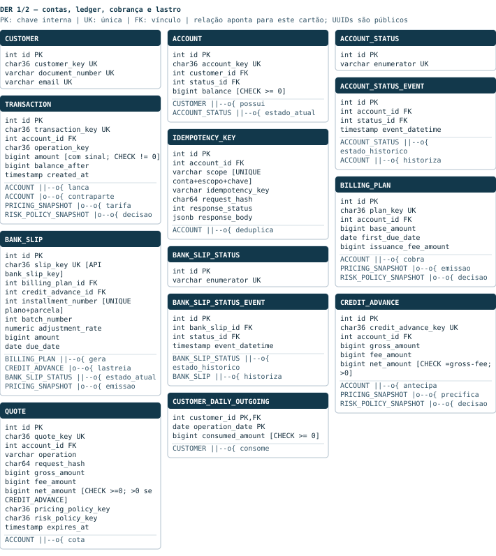
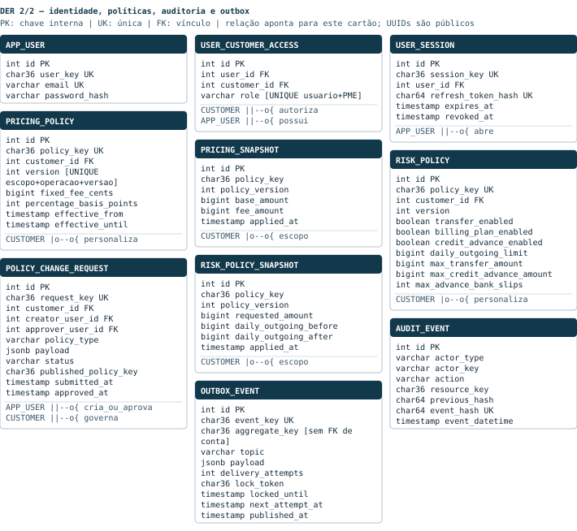

# RFC — BaaS PME: conta, cobrança e liquidez

| | |
|---|---|
| **Time / data / versão** | Cairê Belo · Pedro Campanha · Luka Djukic · 10/10/2026 · 3.4 · [RFC integral](../RFC.md) |

## Contextualização

### Entendendo o problema

Uma PME precisa cobrar, movimentar o caixa e antecipar recebíveis com segurança. Duplicar dinheiro ou lastro e perder o histórico comprometem a confiança no saldo. A solução reúne essas operações com identidade, personalização e auditoria. Empréstimo, baixa automática, estorno, múltiplas moedas e SLO ficam fora do escopo. Apresentamos **garantias verificadas e limitações conhecidas**: o líquido positivo está implementado, mas as demais fronteiras de P0.4 seguem pendentes.

### Explicando a solução de forma macro

Um serviço HTTP modular e um worker compartilham o PostgreSQL. O fluxo passa por middleware, schema, resource, controller, repository e model/DTO; conectores e MockServer isolam o I/O. Travas, commit e idempotência protegem o dinheiro, enquanto auditoria e outbox registram os fatos. Há exceções à separação de camadas: preço e risco nos repositories, além de SQL na auditoria. Não há gateway nem frota de microserviços.

- **Microserviço por operação** fragmentaria a transação ACID, mas serviria a domínios e deploys independentes. **Lock otimista** exigiria repetir decisões sob disputa, mas seria útil com baixa contenção.
- **Float** perde precisão; **NUMERIC** seria exato, mas centavos simplificam o contrato. Frações de centavo justificariam NUMERIC. **Soft delete** oculta o histórico e serviria a dados descartáveis, não a fatos financeiros.

## Implementação

### Rotas

O token interno é obrigatório, exceto na raiz e na saúde. Nas contas, o JWT, quando presente, valida PME e papel; propostas exigem OWNER. Bootstrap, políticas diretas, auditoria e métricas não têm RBAC próprio. O erro QIT usa `{title, description, translation, code}`, sem seguir integralmente a RFC 9457. Os erros globais são 403 para token, 401 para JWT, 403 para papel e 503 para timeout SQL. O replay combina UNIQUE(conta,escopo,chave), hash e resposta; os contratos estão em [DECISOES](../DECISOES.md).

| Método | Caminho | Função / idempotência | Entrada | Saídas (status e quando) |
|---|---|---|---|---|
| GET | `/` | Identifica | — | 200 |
| GET | `/health_check` | Liveness | — | 204 |
| POST | `/customer` | Cadastra | CPF/CNPJ, e-mail | 201; 400 schema; 409 duplicado; 422 documento |
| GET | `/customer/{customer_key}` | Consulta | UUID | 200; 404 ausente |
| POST | `/account` | Abre conta | PME | 201; 400 schema; 404 PME |
| GET | `/account/{account_key}` | Consulta | UUID | 200; 404 conta |
| PUT | `/account/{account_key}/block` | Bloqueia | OWNER* | 200; 404 conta; 409 estado |
| PUT | `/account/{account_key}/cancel` | Cancela | OWNER* | 200; 404 conta; 409 estado |
| POST | `/account/{account_key}/transaction` | Movimenta/replay | tipo, valor, destino, chave | 201; 400 contrato; 404 conta; 409 estado/chave/produto; 422 saldo/limite/destino; 503 retry |
| GET | `/account/{account_key}/transaction/{transaction_key}` | Lançamento | UUIDs | 200; 404 ausente/alheio |
| GET | `/account/{account_key}/transactions` | Extrato | página/limite/tipo | 200; 400 consulta; 404 conta |
| POST | `/account/{account_key}/billing-plan` | Lote 1 | base, data | 201; 400 schema; 404 conta; 409 estado/produto; 422 data/tarifa; 502 emissor |
| GET | `/account/{account_key}/billing-plan/{plan_key}` | Plano | UUIDs | 200; 404 ausente/alheio |
| POST | `/account/{account_key}/billing-plan/{plan_key}/adjustment` | Lote 2 | índice | 201; 400 schema; 404 plano; 409 lote/estado/produto; 422 tarifa; 502 conector |
| POST | `/account/{account_key}/credit-advance` | Antecipa/replay | boletos, chave | 201; 400 contrato; 404 lastro; 409 estado/chave/lastro/produto; 422 risco/líquido; 503 retry |
| POST | `/pricing-policy` | Preço direto | PME, tarifa | 201; 400 schema; 404 PME |
| POST | `/risk-policy` | Risco direto | PME, limites | 201; 400 schema; 404 PME |
| POST | `/account/{account_key}/quote` | Prévia | produto, valor/lastro | 201; 400 schema; 404 conta/lastro; 409 produto/lastro; 422 risco/líquido de antecipação |
| POST | `/policy-change-request` | DRAFT | política, OWNER | 201; 400 schema; 401 JWT; 403 vínculo; 404 PME |
| PUT | `/policy-change-request/{request_key}/submit` | Submete | criador | 200; 401 JWT; 403 vínculo; 404 proposta; 409 ator/estado |
| PUT | `/policy-change-request/{request_key}/approve` | Aprova | outro OWNER | 200; 401 JWT; 403 vínculo; 404 proposta; 409 ator/estado |
| POST | `/user` | Usuário | PME, senha, papel | 201; 400 schema/senha; 404 PME; 409 e-mail |
| POST | `/auth/login` | Nova sessão | credenciais | 201; 400 schema; 401 credenciais |
| POST | `/auth/refresh` | Rotaciona | refresh | 201; 400 schema; 401 inválido/usado |
| POST | `/auth/logout` | Revoga | JWT | 204; 401 sessão |
| GET | `/audit-events` | Cadeia | token | 200; 403 token |
| GET | `/audit-events/checkpoint` | Ponta | token | 200; 403 token |
| GET | `/metrics` | Métricas | token | 200; 403 token |

*OWNER é exigido quando há JWT. Escritas sem “replay” criam nova entidade ou versão. Repetir mudanças de estado, lote 2 ou proposta gera conflito; refresh é de uso único e logout recusa sessão revogada.

<!-- page -->

### Banco de Dados (Somente diagrama)

<!-- page -->

<!-- page -->

### Fluxos

> ## Principal desafio
>
> Manter saldo e ledger coerentes sob concorrência e perda de resposta exige cuidado: uma leitura sem trava pode autorizar débitos incompatíveis, e um timeout não revela se houve commit. A solução trava pelo ID interno, recarrega os dados e usa CHECK, confirmando ledger, saldo e resposta idempotente juntos. A garantia exige que toda escrita siga esse caminho; não cobre ações do administrador nem todas as falhas possíveis.

**Cadastro, dinheiro e estado**

O cadastro valida schema estrito, documento e duplicidade, cria o UUID e registra a transição PENDING→APPROVED. Com a conta travada, a movimentação recebe um lançamento com sinal contábil. Bloqueio e cancelamento gravam estado, evento, auditoria e outbox em um único commit do controller; CANCELLED é terminal. Duplicidade ou estado inválido retornam 409; documento ou saldo inválido, 422. A falha causa rollback sem esperar crédito futuro. Cancelar não liquida saldo nem boletos automaticamente.

**Transferência, preço e risco**

Após reservar a idempotência, a operação trava as contas por ID crescente com `FOR NO KEY UPDATE`, compatível com KEY SHARE da FK, e relê os dados. A política da PME prevalece sobre a padrão; a tarifa é fixo + half-up(bruto×bps/10000), com a escolha congelada em snapshot. O risco verifica habilitação e tetos por operação e por dia; um advisory lock por PME e data serializa o consumo. TRANSFER_OUT/IN/FEE compartilham operation_key, e saldo, ledger, snapshots, consumo, auditoria e resposta confirmam juntos.

Produto ou estado inválido retornam 409; saldo ou teto, 422, sem consumo parcial. Transferências A→B e B→A podem esperar circularmente sem ordenação; travar primeiro o menor ID faz uma aguardar a outra. A ordem usa ID, nunca IP. Falta de saldo é uma recusa de negócio, sem deadlock ou retry.

**Regra noturna:** saques e transferências acima de R$ 1.000 retornam 422 entre 20h e 6h, em America/Sao_Paulo, para qualquer conta; depósitos não são limitados. O teto diário comercial considera o principal transferido, mas a data do runtime ainda precisa ser alinhada ao fuso.

**Idempotência, timeout e retry**

SHA-256 canônico e UNIQUE(conta,escopo,chave) serializam reenvios. O mesmo corpo recupera o 201 original com Idempotent-Replayed; outro corpo retorna 409, e uma recusa desfaz a reserva. Só transação e antecipação repetem a operação inteira para 40P01/40001, com rollback e nova sessão, até duas tentativas totais. Não há retry para 4xx ou conector, nem espera por dinheiro.

Esgotar as tentativas retorna 503/QIT001025; timeout SQL, 503/QIT001024. Após perder a resposta, o cliente reenvia a mesma chave. As esperas são de 1s/5s no serviço externo e 2s/10s no banco, com orçamento de 15s, sem deadline global rígido.

**Cobrança, reajuste e antecipação**

O lote 1 emite 12 recebíveis da PME para pagadores externos, com vencimentos mensais ajustados ao fim do mês e tarifa de serviço separada. O lote 2 consulta IPCA/IGPM, trava o plano e reajusta as parcelas 13–24 com Decimal half-up, emitindo uma vez localmente. A antecipação trava a conta e os boletos próprios PENDING ainda não consumidos, soma o bruto, aplica risco e valida tarifa e líquido antes do snapshot de preço. A escolha é persistida; crédito bruto, débito da tarifa positiva e vínculo do lastro entram no commit idempotente. Antecipar não muda PENDING para PAID.

Uma falha externa retorna 502 e desfaz a escrita local, mas não a emissão externa. O lote 2 mantém o lock durante I/O, e a criação não tem replay. Lastro alheio ou inexistente retorna o mesmo 404; usado, 409. Uma lista inválida desfaz toda a tentativa. Não há empréstimo, amortização ou baixa do pagador.

**Líquido positivo implementado — subparte P0.4:** execução e cotação CREDIT_ADVANCE exigem bruto−tarifa > 0 após half-up. Caso contrário, retornam **422/QIT001030**, sem confirmar dinheiro, lastro, snapshots ou reserva, nem repetir a recusa de negócio. Para bruto de R$100, tarifas de R$3 e R$99,99 deixam R$97 e R$0,01; R$100 ou R$120 são recusados, preservando um saldo anterior de R$500. A tarifa de R$120 pode valer para bruto de R$1.000. O replay preserva a resposta confirmada; CHECKs e migração protegem novas gravações sem reescrever o legado. Os testes HTTP/SQL estão em COBERTURA; os demais itens 9.5 seguem pendentes.

**Cotação e quatro olhos**

A quote de transferência, plano ou antecipação dura 60s e persiste uma prévia, sem reservar saldo, limite, lastro ou preço. A execução recalcula e não aceita quote_key nem tarifa do cliente. Um OWNER cria DRAFT e o criador submete PENDING_APPROVAL; outro OWNER aprova sob lock e publica a versão no commit. A vigência anterior termina, sem reprecificar snapshots. Propostas pendentes não valem; autoaprovação e repetição retornam 409, e papel ou PME inválidos, 403. Rotas diretas contornam a aprovação; RETIRED não tem transição entregue. O líquido de quote TRANSFER com tarifa alta permanece uma lacuna.

**Identidade e autorização**

As senhas usam bcrypt, com limite de 72 bytes UTF-8. O login emite acesso de 15min e refresh opaco rotativo, cujo hash é persistido, para uma sessão de até 8h. Dispositivos têm sessões independentes e logout individual. Com JWT, VIEWER lê e cota, OPERATOR movimenta e OWNER altera estado; propostas exigem OWNER. O token interno técnico tem autoridade ampla e pode dispensar JWT nas contas. Credenciais ou JWT inválidos retornam 401; vínculo ou papel, 403. Uma proposta com sessão revogada pode retornar 403. O login não revela e-mail. Rate limit, rotação, provisionamento e gateway não foram entregues; UUID não substitui autorização.

**Extrato, auditoria e outbox**

O extrato ordena por data e ID; valores com sinal contábil reconstroem o saldo de uma conta estável. Lançamento alheio ou inexistente retorna o mesmo 404; offset não congela páginas diante de novas escritas. A auditoria encadeia SHA-256 sob lock global e exporta cadeia e checkpoint; o ID sequencial administrativo é uma exceção documentada. Um trigger impede UPDATE/DELETE apenas de audit_event. Ledger, estados e snapshots dependem da aplicação, e o administrador pode adulterá-los; não é blockchain.

A outbox de bloqueio e cancelamento confirma com o domínio. O worker usa claim SKIP LOCKED e lease, envia o event_key por webhook e faz ack em transações separadas. Falhas agendam backoff; uma queda após o aceite ou um lease vencido pode duplicar a entrega, exigindo deduplicação pelo consumidor. A garantia é at-least-once, sem dead-letter, envelope versionado ou exactly-once externo.

**Pipelines e evidências**

A CI de push/PR prepara dependências, Compose e compilação, executa guardas e a suíte completa com bootstrap isolado e preserva JUnit, métricas e metadados. O pytest cria DB, mock, portas livres e API às 21h. Uma segunda API verifica 19:59/20h, meia-noite, 05:59/6h, 12h e replay dia→noite, sem escolher relógio por HTTP ou reiniciar o desenvolvimento; o cleanup remove apenas a sessão. Bootstrap, SQL e worker não são prova HTTP. A jornada cobre quatro olhos, cobrança, reajuste, cotação, antecipação, replay, dinheiro, extrato, estado e auditoria.

Logs JSON com X-Request-ID mascaram identificadores e omitem body; tracebacks podem conter SQL/URLs. Métricas internas cobrem HTTP, QIT, replay, conectores, locks, retry, sessões e outbox, com registry por processo e gauges persistidas. Alertas são propostas, sem Prometheus, Alertmanager ou cAdvisor instalado. O benchmark de 5×40 transferências cruzadas amostra CPU/RAM como observação local, sem SLO.

Resultados, datas e comandos estão em [COBERTURA](../COBERTURA.md), [BENCHMARK](../BENCHMARK.md) e [ENTREGA](ENTREGA.md). CI e publicação foram confirmados em `1603118`; novas revisões exigem novo CI. Clone, aceite e ensaio do grupo seguem pendentes. O legado sample_entity está ativo, e a biblioteca não participa do produto. A RFC integral e DECISOES preservam os detalhes; os demais itens 9.5 ficam fora deste trabalho.

